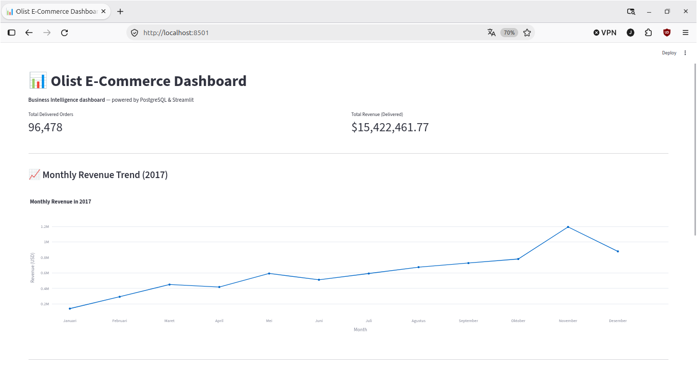
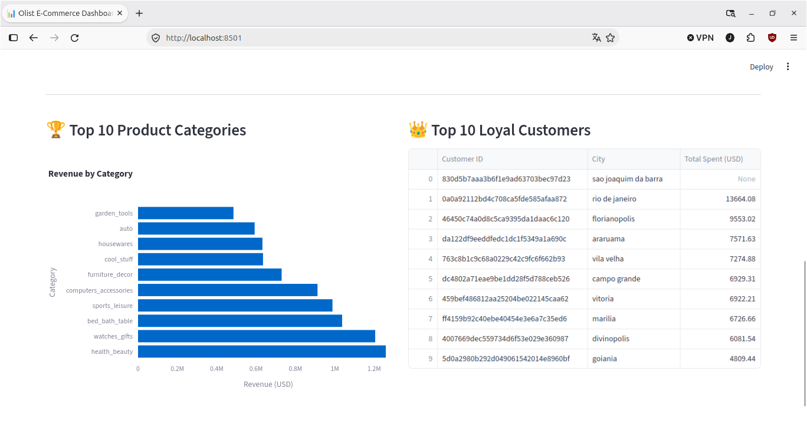
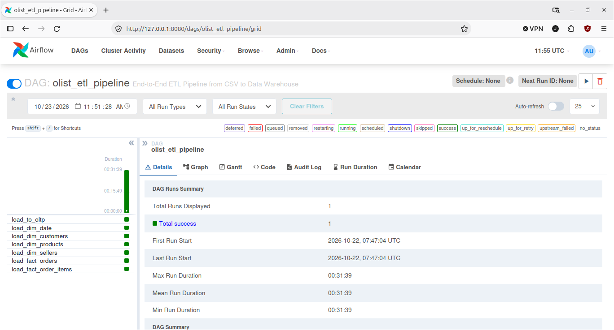

# Olist E-Commerce Data Warehouse & ETL Pipeline

An End-to-End Data Engineering Project: From raw Kaggle CSV to an Automated Interactive Dashboard.

## 📸 Dashboard Preview



*Key Performance Indicators and Monthly Revenue Trend (2017).*



*Top 10 Product Categories and Top 10 Loyal Customers.*

## 🏗️ Architecture Diagram

```text
┌─────────────────┐
│  Raw CSV Files  │
└────────┬────────┘
         │
         ▼  (Python + Pandas + SQLAlchemy)
┌─────────────────┐
│ PostgreSQL OLTP │ (Operational Database)
└────────┬────────┘
         │
         ▼  (Star Schema Transformation)
┌─────────────────┐
│  Data Warehouse │ (Fact & Dimension Tables)
└────────┬────────┘
         │
         ▼  (Apache Airflow - LocalExecutor)
┌─────────────────┐
│  Orchestration  │ (Automated ETL Pipeline)
└────────┬────────┘
         │
         ▼  (Streamlit + Plotly)
┌─────────────────┐
│    Dashboard    │ (Business Intelligence)
└─────────────────┘
```

## ⚙️ Airflow Pipeline Orchestration

The ETL process is fully automated and orchestrated using Apache Airflow. The DAG handles dependencies, ensuring dimension tables are built before fact tables.



## 🛠️ Tech Stack & Structure

### Tech Stack

- Language: Python 3.13
- Database: PostgreSQL 18
- Orchestration: Apache Airflow 2.9.2
- Visualization: Streamlit & Plotly
- Containerization: Docker & Docker Compose
- Data Processing: Pandas & SQLAlchemy

### 📂 Folder Structure

```text
olist-warehouse/
├── dags/                  # Apache Airflow DAG definitions
├── dashboard/             # Streamlit application (app.py, Dockerfile)
├── data/
│   ├── raw/               # Place the 9 raw Olist CSV files here
│   └── batches/           # Generated monthly batches (for incremental load)
├── scripts/
│   ├── docker-init.sh     # Auto-init script for Docker PostgreSQL
│   └── split_csv.py       # Utility to split data into batches
├── sql/
│   └── 01_create_schema.sql # DDL for Star Schema & Watermark
├── src/
│   ├── utils/             # Logger, Retry decorator, Validation
│   ├── load_to_oltp.py    # Extract & Load CSV to OLTP
│   ├── load_dim_*.py      # Load Dimension tables
│   ├── load_fact_*.py     # Load Fact tables
│   └── load_warehouse_incremental.py # Incremental batch loader
├── airflow.Dockerfile     # Custom Airflow image with dependencies
├── docker-compose.yml     # Main orchestration file
├── requirements.txt       # Main Python dependencies
└── README.md
```

## ✨ Key Engineering Decisions

- **Docker Network Isolation:** Used Docker Compose environment variables to override localhost with the service name postgres. This ensures Python scripts and Airflow correctly resolve database addresses inside the container network.
- **Lightweight Orchestration (LocalExecutor):** Chose Airflow's LocalExecutor over CeleryExecutor to keep RAM usage minimal (under 1GB) and avoid unnecessary infrastructure complexity for a pipeline of this scale.
- **Auto-Initialized Schema:** Utilized docker-entrypoint-initdb.d to automatically create databases and build the Star Schema upon the first container startup, making the environment zero-configuration.
- **Idempotent & Fault-Tolerant:** Implemented ON CONFLICT DO NOTHING and a custom Watermark Table to ensure incremental loads are safe from data duplication even if the pipeline crashes and restarts.
- **Fan-out Prevention via Pre-aggregation:** When building fact_orders, the order_items and order_payments tables were pre-aggregated by order_id before joining. This prevents data duplication (fan-out) caused by one-to-many relationships, ensuring the fact table grain remains strictly 1 row per order.
- **Schema Initialization Isolation:** Prevented schema bleeding by mounting the DDL script to a custom directory (/docker-init/) instead of the default docker-entrypoint-initdb.d. The schema is explicitly executed only against the olist_warehouse database, keeping olist_oltp clean.

## 🚀 How to Run (Step-by-Step)

(Note: We use modern docker compose syntax. If you are on legacy Docker Compose V1, replace with docker-compose)

### 1. Clone the Repository

```bash
git clone https://github.com/jatiragil/olist-warehouse.git
cd olist-warehouse
```

### 2. Setup Environment

Copy the example environment file and fill in your credentials.

```bash
cp .env.example .env
```

### 3. Download the Dataset

Download the [Brazilian E-Commerce Public Dataset by Olist](https://www.kaggle.com/datasets/olistbr/brazilian-ecommerce) from Kaggle.
Extract all 9 CSV files into the data/raw/ directory.

### 4. Start the Containers

Spin up PostgreSQL, Airflow, and Streamlit simultaneously.

```bash
docker compose up -d --build
```

### 5. Run the ETL Pipeline (via Airflow)

- Open Airflow at http://localhost:8080 (User: admin, Pass: admin).
- Unpause the olist_etl_pipeline DAG.
- Trigger the DAG manually to run the entire pipeline from OLTP to the Data Warehouse.

### 6. View the Dashboard

Open Streamlit at http://localhost:8501 to see the business insights.

## 🧠 Key Challenges & Solutions

- **The "Localhost" Trap in Docker:** Initially, Python scripts failed to connect to the database from inside the container. Solution: Overrode localhost with the Docker service name postgres via environment variables.
- **Resource Constraints (3GB RAM):** Running Airflow's default CeleryExecutor froze the local machine. Solution: Switched to LocalExecutor and baked dependencies into a custom Dockerfile to drastically reduce memory footprint and startup time.
- **Simulating Production Incremental Loads:** The static Kaggle dataset lacks daily updates. Solution: Built a custom split_csv.py to partition data into monthly batches and implemented a Watermark Table (etl_watermark) to demonstrate fault-tolerant, idempotent batch processing.
- **Data Quality Realities:** Validation detected 623 products with missing categories and 4 orders without items. Instead of treating them as pipeline errors and forcing default values, they were documented as real dataset characteristics, proving that validation is about understanding data, not just finding bugs.
- **Composite Key Validation:** Initial validation logic reported 13,984 false duplicates in fact_order_items. It was later discovered that the validation only checked the first column (order_id) instead of the composite primary key (order_id, item_id). Fixing the validation query resolved the false positives.

## 🧠 Advanced Feature: Incremental Loading

While the Airflow DAG handles the initial full load, this project also includes an Incremental Load feature. The pipeline can split raw CSVs into monthly batches and load them incrementally using a Watermark Table (dw.etl_watermark) via CLI. This simulates a production scenario where data arrives daily.

---

Author: Jati Ragil

- GitHub: [@jatiragil](https://github.com/jatiragil)
